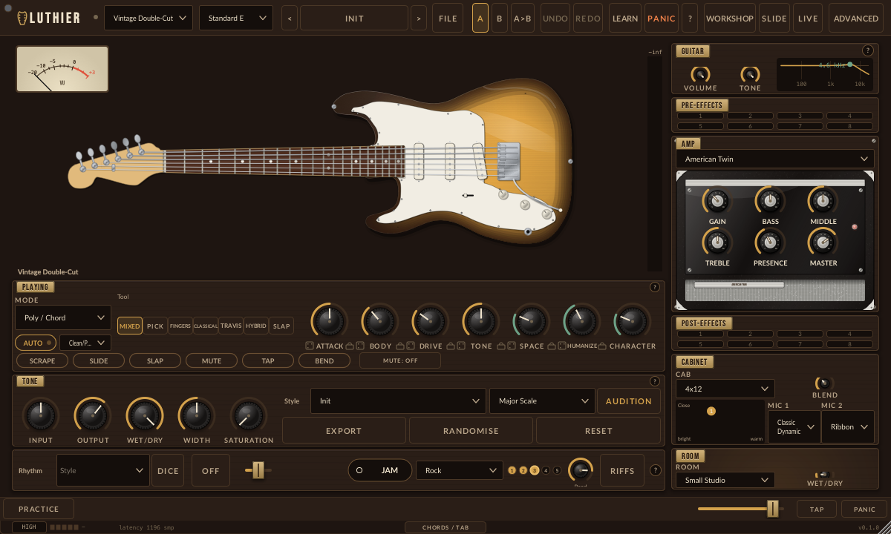
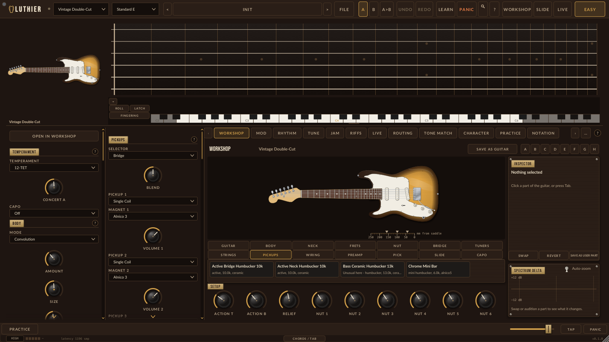
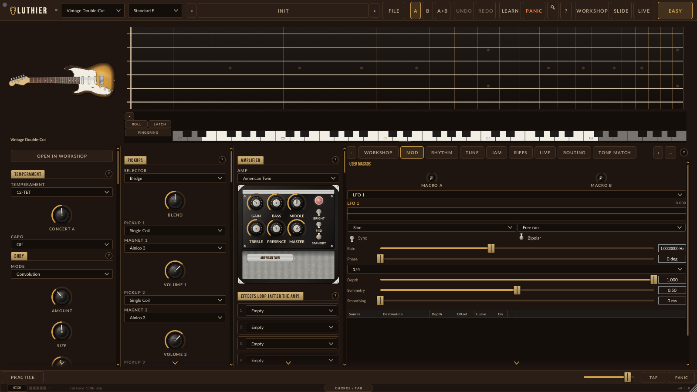
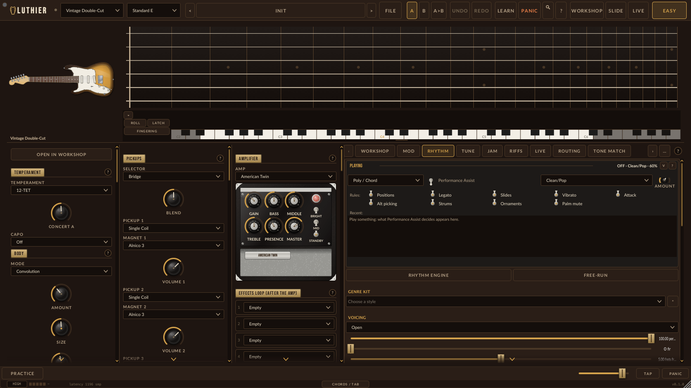
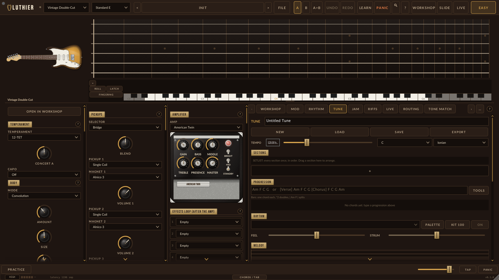
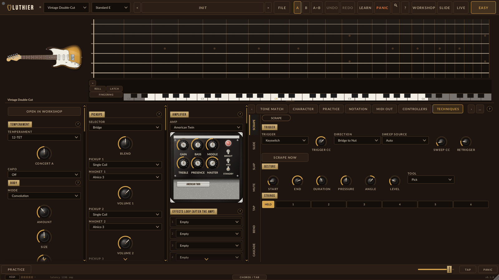

# Luthier

Luthier is a software artwork and a physically modelled guitar instrument,
built with JUCE 8 for VST3, AU, CLAP and standalone use. Every note is a digital waveguide string coupled through a bridge to a
body, a pickup, a guitar circuit, an amp, a cabinet and a room. There are no
samples in it.

The full front page, with the content counts, architecture, DSP rules and the
deliberate deviations from the brief, is [spec/README.md](spec/README.md).

The reference pedalboard is in development and is not release-qualified. 13 models
are registered today (10 generic effects and 3 prototypes); the six named models
planned for the first pedalboard release are not available yet. See the
[pedalboard guide](docs/PEDALBOARD.md), the [effects reference](docs/EFFECTS_REFERENCE.md),
[known issues](docs/KNOWN_ISSUES.md) and the
[pedalboard acceptance ledger](docs/coverage/PEDALBOARD-ACCEPTANCE.md).

## Feature screenshots

These images were rendered from the Luthier Pro JUCE editor, not drawn as concept mockups. They were not regenerated for the current source, so details may differ.

### Easy mode: instrument and macro controls



### Guitar Workshop



### Modulation matrix



### Rhythm tools



### Tune arrangement



### Playing techniques



See the [user manual](docs/USER_MANUAL.md) for more features and controls.

## Build

Requirements: CMake 3.22+, a C++17 compiler (MSVC 2022, Xcode 14, GCC 11 or
Clang 14) and JUCE 8.0.10 in `ThirdParty/JUCE`:

```bash
git clone --depth 1 --branch 8.0.10 https://github.com/juce-framework/JUCE.git ThirdParty/JUCE
cmake -B build -DCMAKE_BUILD_TYPE=Release
cmake --build build --config Release --parallel 2
```

On Windows use `-G "Visual Studio 17 2022" -A x64`. On Linux,
`scripts/setup_linux.sh` installs the system packages JUCE needs. The targets
are `Luthier_VST3`, `Luthier_Standalone`, `Luthier_AU` (macOS), `Luthier_CLAP`
(when `ThirdParty/clap-juce-extensions` is present), `LuthierTests` and
`LuthierRender` (the `luthier-render` offline renderer).

## Test

```bash
./build/LuthierTests_artefacts/Release/LuthierTests            # everything
./build/LuthierTests_artefacts/Release/LuthierTests Presets    # a suite, or any name fragment
./build/LuthierTests_artefacts/Release/LuthierTests --list
ctest --test-dir build -C Release -R LuthierRenderCli          # luthier-render smoke test
```

On a headless Linux machine, run the test binary under `xvfb-run -a`. CI
(`.github/workflows/build.yml`, driven by `scripts/ci_build.sh` and
`scripts/ci_build.ps1`) builds on Windows, macOS and Linux, runs the tests and
validates the plugin with pluginval (strictness 5 on push and pull request, up to
10 on manual dispatch) and clap-validator. See [docs/TESTING.md](docs/TESTING.md);
the test state of the current source is in
[docs/KNOWN_ISSUES.md](docs/KNOWN_ISSUES.md), "Platform qualification". To run
pluginval by hand:

```bash
pluginval --strictness-level 10 --validate build/Luthier_artefacts/Release/VST3/Luthier.vst3
```

## Documentation

| | |
|---|---|
| [spec/README.md](spec/README.md) | product overview, architecture, source layout, runtime folders |
| [docs/USER_MANUAL.md](docs/USER_MANUAL.md) | every screen and control |
| [docs/PEDALBOARD.md](docs/PEDALBOARD.md) | the reference pedalboard: opening, editing, MIDI learn, limits |
| [docs/EFFECTS_REFERENCE.md](docs/EFFECTS_REFERENCE.md) | every effect control, for the pedalboard models and the legacy racks |
| [docs/PLAYING_TECHNIQUES.md](docs/PLAYING_TECHNIQUES.md) | how MIDI becomes technique, and the controller map |
| [docs/GUITAR_PHYSICS.md](docs/GUITAR_PHYSICS.md) | the physics behind the model |
| [docs/PRESET_FORMAT.md](docs/PRESET_FORMAT.md) | the `.luthierpreset` file format |
| [docs/MIDI_EXPORT_LUTHIER_PROFILE.md](docs/MIDI_EXPORT_LUTHIER_PROFILE.md) | the Luthier MIDI export profile |
| [docs/KEYBOARD_SHORTCUTS.md](docs/KEYBOARD_SHORTCUTS.md) | keyboard shortcuts |
| [docs/TROUBLESHOOTING.md](docs/TROUBLESHOOTING.md) | install, presets, CPU, crashes |
| [docs/HOST_COMPATIBILITY.md](docs/HOST_COMPATIBILITY.md) | intended per-host handling (no host has been tested manually) |
| [docs/TESTING.md](docs/TESTING.md) | running the tests, sanitizers, validators |
| [CONTRIBUTING.md](CONTRIBUTING.md) | build, rules, commits, adding a test or a board model |
| [spec/cli-tools.md](spec/cli-tools.md) | notation commands and every `luthier-render` flag |
| [docs/wiki-draft/Home.md](docs/wiki-draft/Home.md) | wiki drafts: users and developers |
| [docs/RELEASING.md](docs/RELEASING.md) | the release checklist |
| [docs/CHANGELOG.md](docs/CHANGELOG.md), [docs/KNOWN_ISSUES.md](docs/KNOWN_ISSUES.md) | history and open issues |
| [spec/](spec/) | the specifications the code is built to; `spec/INDEX.md` lists them |
