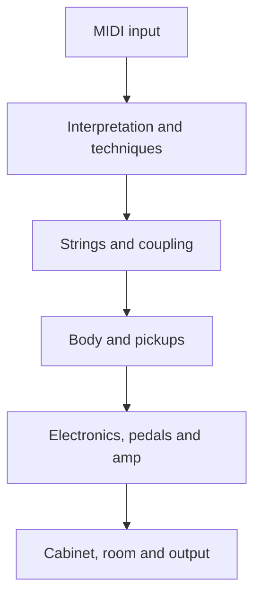

# Architecture

Luthier processes MIDI through interpretation and playing techniques, computes string pitch and excitation, and renders string, body and pickup response before passing the result through guitar electronics, pedals, amplifier, cabinet, room and master output. The engine uses per-string waveguides and sympathetic coupling. The body can use generated impulse responses or modal synthesis; the pickup includes position and electrical response.

## Where the pedalboard sits

The reference pedalboard is a separate subsystem from the two legacy pedal racks. Each board pedal has a placement: before the legacy pre-effects rack, after the legacy post-effects rack (before the cabinet), or after the cabinet (before the room). See `Source/LuthierEngine.cpp` (the three `referencePedals.processStereo` calls) and [Pedalboard](https://github.com/djshellshoxxx/luthier/blob/master/docs/PEDALBOARD.md).

## Source map

- `Source/DSP/`: signal processing (String, Coupling, Body, Pickup, Circuit, Effects, Amp, Master, Common and others).
- `Source/Model/`: guitar, playing and workshop models.
- `Source/ReferencePedals/`: the pedalboard engine and models. `Source/UI/ReferencePedals/`: its interface.
- `Source/UI/`: the editor, panels and illustration. (Earlier drafts of this page named `Source/GUI/`; that folder does not exist.)
- `Source/Presets/`, `Source/Support/`, `Source/Notation/`, `Source/Tune/`, `Source/Rhythm/`: feature areas.
- `Source/Tests/`: the test runner and every test.
- `Tools/RenderCli.cpp`: the offline renderer. `Resources/`: factory content. `packaging/`: installers.

CMake still contains a rule that excludes `Source/WIP/`, but no such folder exists at this commit.

## Entry points

[`spec/README.md`](https://github.com/djshellshoxxx/luthier/blob/master/spec/README.md) is the original architecture overview, [`spec/engine.md`](https://github.com/djshellshoxxx/luthier/blob/master/spec/engine.md) the DSP rules, [`spec/gui-integration.md`](https://github.com/djshellshoxxx/luthier/blob/master/spec/gui-integration.md) UI placement and [`spec/ui-wiring.md`](https://github.com/djshellshoxxx/luthier/blob/master/spec/ui-wiring.md) parameter and backend attachment. The specs include proposed work; inspect the compiled source and tests before describing a detail as implemented. Start reading the code at `Source/PluginProcessor.cpp` and `Source/LuthierEngine.*`.
